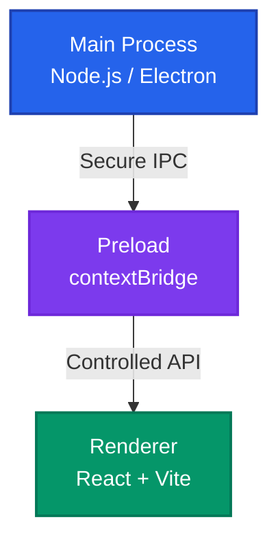
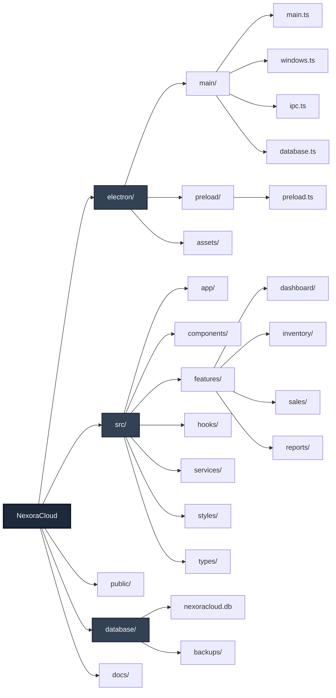
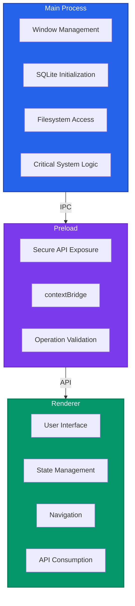
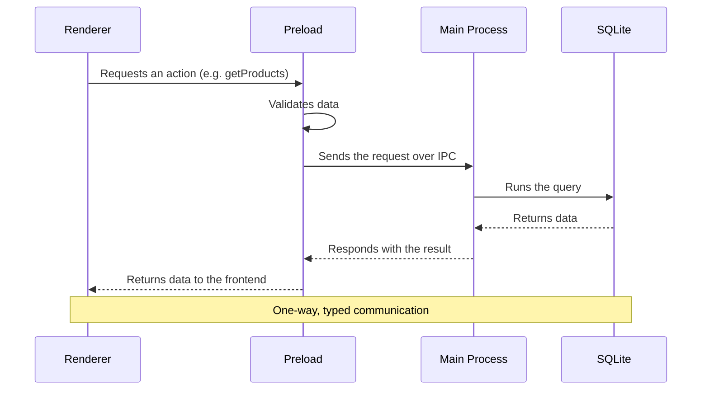
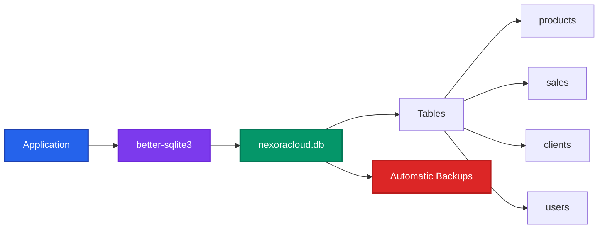
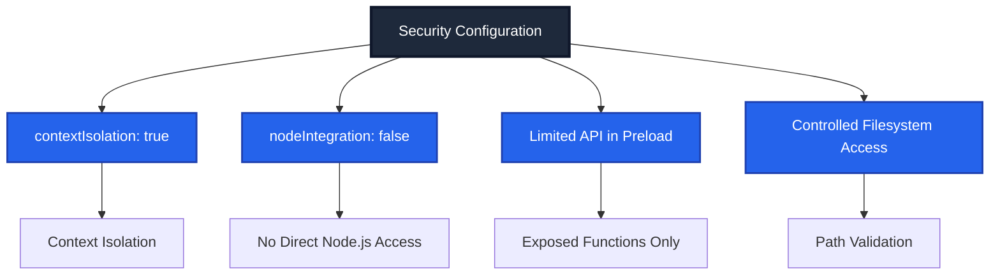
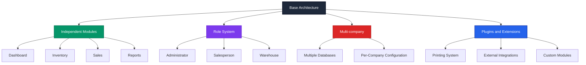

# Project Architecture and Structure

**Project:** NexoraCloud  
**Stack:** Electron + Vite + React + TypeScript + SQLite  
**Goal:** A solid, scalable and maintainable foundation for a 100% local desktop application.

---

## 1. General Architecture

The project follows the standard **Electron** architecture, splitting responsibilities into three layers:

- **Main Process**: Controls the app lifecycle, windows, filesystem and database.
- **Preload**: Secure communication layer between Electron and the frontend.
- **Renderer**: User interface (React).

This separation guarantees **security**, **scalability** and **maintainability**.



---

## 2. Folder Structure



---

## 3. Responsibilities by Layer



### Main Process (electron/main)
- Create and manage windows.
- Initialize SQLite.
- Filesystem access (images, backups).
- Critical system logic.

### Preload (electron/preload)
- Expose safe functions through `contextBridge`.
- Prevent direct Node.js access from the frontend.

Example responsibilities:
- `getProducts()`
- `createSale()`
- `backupDatabase()`

### Renderer (src)
- Render the interface.
- Handle state and navigation.
- Consume the APIs exposed by preload.

---

## 4. IPC Communication



- Only defined channels are used.
- Data is validated before operations run.
- Communication is one-way and typed.

---

## 5. Backup and Protection System (V1.0.0)

The backup system is not just a feature; it is a critical subsystem with its own data-flow architecture.

```mermaid
graph TD
    User[User] -->|Requests Backup| Wizard[BackupWizard UI]
    Wizard -->|Selects Data| Service[ZipBackupService]
    
    subgraph Core Logic
        Service -->|1. Collects JSONs| Data[In-Memory Data]
        Service -->|2. Applies AES-256 (Optional)| Crypto[SecureEncryptionService]
        Crypto -->|3. Builds ZIP| JSZip[JSZip Engine]
    end
    
    JSZip -->|4. .cerobak Blob| FileSaver
    FileSaver -->|Local Download| HDD[Local Disk]
    
    HDD -.->|Manual Upload| Cloud[Google Drive / Dropbox]
    
    style User fill:#1e293b,color:#fff
    style Wizard fill:#059669,color:#fff
    style Service fill:#7c3aed,color:#fff
    style Crypto fill:#dc2626,color:#fff
```

### Key Components
1.  **BackupWizard/RestoreWizard**: UI controllers that manage the process state and animations.
2.  **ZipBackupService**: Orchestrator that coordinates data collection, compression and file generation.
3.  **SecureEncryptionService**: Isolated module dedicated solely to cryptography (PBKDF2 + AES-GCM).

---

## 6. Database



- SQLite as the local engine.
- A single `.db` file.
- Synchronous access through `better-sqlite3`.
- Automatic backups configurable by the user.

---

## 6. Security



---

## 7. Scalability



The architecture makes it possible to:
- Add modules without affecting the core.
- Introduce user roles.
- Support multiple companies.
- Integrate printing or future plugins.

---

This document defines the structural foundation of the project and serves as a reference for the ongoing development of **NexoraCloud**.
