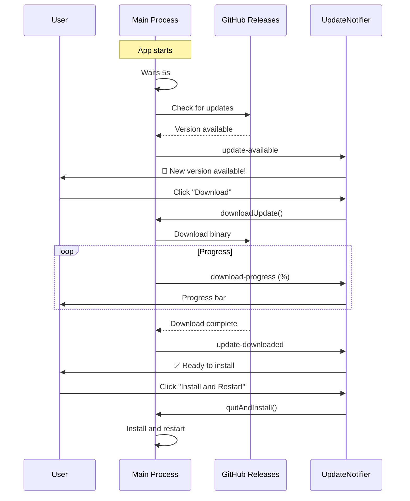

# 🔄 Auto-Update System - NexoraCloud

**Implemented:** October 31, 2026  
**Version:** 1.2.0

---

## 📋 Contents

1. [Overview](#-overview)
2. [Architecture](#-architecture)
3. [Configuration](#-configuration)
4. [User Flow](#-user-flow)
5. [Development and Testing](#-development-and-testing)
6. [Deployment](#-deployment)
7. [Troubleshooting](#-troubleshooting)

---

## 🎯 Overview

NexoraCloud implements a **silent, non-intrusive auto-update system** with:

- ✅ **Automatic checks** every 6 hours
- ✅ **Background download** without interrupting the user
- ✅ **Elegant notifications** using Sonner toasts
- ✅ **Visual progress bar** with Framer Motion animations
- ✅ **Installation on close** of the application (not forced)
- ✅ **GitHub Releases** as the update source
- ✅ **Cross-platform** (Windows, macOS, Linux)

### Technologies Used

- **electron-updater** - Electron's official auto-update system
- **GitHub Releases** - Hosting for binaries and the changelog
- **electron-builder** - Installer generation with digital signing

---

## 🏗️ Architecture

### Components

```
┌─────────────────────────────────────────────┐
│         MAIN PROCESS (Electron)             │
│  ┌───────────────────────────────────────┐  │
│  │  autoUpdater.ts (AutoUpdateService)   │  │
│  │  - electron-updater configuration     │  │
│  │  - Event listeners                    │  │
│  │  - IPC handlers                       │  │
│  │  - Periodic checks                    │  │
│  └─────────────┬─────────────────────────┘  │
│                │ IPC                         │
└────────────────┼─────────────────────────────┘
                 │
┌────────────────▼─────────────────────────────┐
│         PRELOAD SCRIPT                       │
│  - Exposes safe APIs (updater.*)            │
│  - contextBridge.exposeInMainWorld()        │
└────────────────┬─────────────────────────────┘
                 │
┌────────────────▼─────────────────────────────┐
│         RENDERER PROCESS (React)             │
│  ┌───────────────────────────────────────┐  │
│  │  updaterService.ts                    │  │
│  │  - API wrapper                        │  │
│  │  - Subscription system                │  │
│  └─────────────┬─────────────────────────┘  │
│                │                             │
│  ┌─────────────▼─────────────────────────┐  │
│  │  UpdateNotifier.tsx                   │  │
│  │  - Notification toasts                │  │
│  │  - Floating progress bar              │  │
│  │  - Action buttons                     │  │
│  └───────────────────────────────────────┘  │
└─────────────────────────────────────────────┘
```

### Data Flow



---

## ⚙️ Configuration

### 1. GitHub Releases Configuration

The auto-updater is configured in `electron/main/autoUpdater.ts`:

```typescript
autoUpdater.setFeedURL({
    provider: 'github',
    owner: 'CeroCloud',
    repo: 'CeroCloud-Desktop',
})
```

### 2. Environment Variables

In production, the auto-updater needs a **GitHub Personal Access Token** (optional for public repos):

```bash
# .env (only for local release testing)
GH_TOKEN=ghp_your_token_here
```

### 3. electron-builder Configuration

In `package.json`, the publishing configuration:

```json
{
  "build": {
    "publish": {
      "provider": "github",
      "releaseType": "release"
    }
  }
}
```

### 4. Check Interval

By default, the app checks every **6 hours**. To change it:

```typescript
// In main.ts (line ~80)
autoUpdateService.startAutoCheck(12) // Check every 12 hours
```

Or from the frontend:

```typescript
await updaterService.setAutoCheck(true, 12)
```

---

## 👤 User Flow

### End-User Experience

#### 1️⃣ **Silent Check**
- The app checks for updates at startup (after 5s)
- Automatic checks every 6 hours
- **Does not interrupt** the user's work

#### 2️⃣ **Update Available Notification**
```
🎉 New version 1.2.0 available!

[Download]  [✕]
```
- Non-intrusive toast in the top-right corner
- The user can ignore it and keep working
- Does not expire automatically (duration: Infinity)

#### 3️⃣ **Background Download**
The user clicks "Download" → A floating bar appears:

```
┌─────────────────────────────────┐
│ 📥 Downloading update           │
│ v1.2.0                       ⏳ │
│                                 │
│ ██████████░░░░░░░░ 65.3%       │
│ 32.1MB / 49.2MB                │
│ 2.45 MB/s                      │
└─────────────────────────────────┘
```

- Animated progress bar
- Real-time download speed
- The user can keep using the app normally

#### 4️⃣ **Installation**
When the download finishes:

```
✅ Update 1.2.0 downloaded

[Install and Restart]  [✕]
```

- The user decides **when** to install
- Clicking it → Closes the app and installs
- It **reopens automatically** with the new version

---

## 🛠️ Development and Testing

### Local Testing

#### 1. **Simulate a new version**

```bash
# 1. Bump the version in package.json
"version": "1.0.1"

# 2. Build the app
npm run build:win

# 3. Create a release on GitHub with the tag v1.0.1
# 4. Upload the generated .exe as a release asset
```

#### 2. **Testing in development**

The auto-updater does **NOT work in development mode** (`npm run dev`). It only works in packaged builds.

```typescript
// In main.ts, it is only enabled in production:
if (app.isPackaged && mainWindow) {
    autoUpdateService = new AutoUpdateService(mainWindow)
    autoUpdateService.startAutoCheck(6)
}
```

#### 3. **Debugging logs**

Logs are saved in:
- **Windows**: `%USERPROFILE%\AppData\Roaming\nexoracloud\logs\main.log`
- **macOS**: `~/Library/Logs/nexoracloud/main.log`
- **Linux**: `~/.config/nexoracloud/logs/main.log`

View the logs in real time:

```bash
# Windows
Get-Content "$env:APPDATA\nexoracloud\logs\main.log" -Tail 50 -Wait

# macOS/Linux
tail -f ~/Library/Logs/nexoracloud/main.log
```

---

## 🚀 Deployment

### Release Process

#### 1. **Prepare a new version**

```bash
# 1. Update the version in package.json
npm version minor  # 1.0.0 → 1.1.0
# or
npm version patch  # 1.0.0 → 1.0.1

# 2. Update CHANGELOG.md
# 3. Commit and push
git add .
git commit -m "chore: release v1.1.0"
git push origin main
```

#### 2. **Create the GitHub Release**

```bash
# Option A: Manually in the GitHub UI
# 1. Go to https://github.com/CeroCloud/CeroCloud-Desktop/releases
# 2. Click "Draft a new release"
# 3. Create a tag (e.g. v1.1.0)
# 4. Write the release notes
# 5. Upload the binaries (.exe, .dmg, .AppImage)

# Option B: Automated with the gh CLI
gh release create v1.1.0 \
  --title "v1.1.0 - Completeness" \
  --notes-file changelog.md \
  release/NexoraCloud\ Setup\ 1.1.0.exe
```

#### 3. **Cross-platform build**

```bash
# Windows
npm run build:win

# macOS (requires macOS)
npm run build:mac

# Linux
npm run build:linux
```

### Required Release Assets

For the auto-updater to work, the release **MUST** include:

**Windows:**
- `NexoraCloud-Setup-1.1.0.exe` (NSIS installer)
- `latest.yml` (metadata, generated automatically by electron-builder)

**macOS:**
- `NexoraCloud-1.1.0.dmg`
- `latest-mac.yml`

**Linux:**
- `NexoraCloud-1.1.0.AppImage`
- `latest-linux.yml`

### Automatic CI/CD (GitHub Actions)

Create `.github/workflows/release.yml`:

```yaml
name: Build and Release

on:
  push:
    tags:
      - 'v*'

jobs:
  release:
    runs-on: ${{ matrix.os }}
    strategy:
      matrix:
        os: [windows-latest, macos-latest, ubuntu-latest]

    steps:
      - uses: actions/checkout@v3
      - uses: actions/setup-node@v3
        with:
          node-version: 20

      - run: npm ci
      - run: npm run build
        env:
          GH_TOKEN: ${{ secrets.GITHUB_TOKEN }}
```

---

## 🔧 Troubleshooting

### Common Problems

#### 1. **"No updates" even though there is a new release**

**Causes:**
- The version in `package.json` was not bumped
- The release tag does not follow the semver format (`v1.0.0`)
- The `.yml` assets were not uploaded to the release

**Solution:**
```bash
# Check the version
npm version

# Check the tag
git describe --tags

# Regenerate the release
npm run build
```

#### 2. **Error "Cannot find latest.yml"**

**Cause:** electron-builder did not generate the metadata files.

**Solution:**
```bash
# Make sure build.publish is configured in package.json
npm run build -- --publish never
# This generates the .yml files without publishing
```

#### 3. **"Update check failed" in the logs**

**Cause:** A network or GitHub configuration problem.

**Solution:**
```bash
# Check connectivity
curl -I https://api.github.com/repos/CeroCloud/CeroCloud-Desktop/releases/latest

# Check the configuration in autoUpdater.ts
# owner: 'CeroCloud'
# repo: 'CeroCloud-Desktop'
```

#### 4. **The update downloads but does not install**

**Cause:** Insufficient permissions (Windows UAC, macOS Gatekeeper).

**Solution:**
- **Windows:** Sign the .exe with a code-signing certificate
- **macOS:** Notarize the app with an Apple Developer ID

---

## 📊 Metrics and Monitoring

### Events that can be tracked

```typescript
updaterService.subscribe((status) => {
    // Send to analytics
    analytics.track('UpdaterEvent', {
        event: status.event,
        version: status.data?.version,
        timestamp: new Date(),
    })
})
```

### Suggested KPIs

- **Adoption rate**: % of users who install updates
- **Average download time**: MB/s per region
- **Error rate**: % of failed attempts
- **Time to install**: Days between release and update

---

## 🔒 Security

### Code Signing

**Windows:**
```bash
# Required to avoid SmartScreen warnings
# Get a certificate from Sectigo/DigiCert
# Configure it in electron-builder:
"win": {
  "certificateFile": "path/to/cert.pfx",
  "certificatePassword": "<env:CERT_PASSWORD>"
}
```

**macOS:**
```bash
# Notarization with Apple
# Required since macOS 10.15+
export APPLE_ID="you@email.com"
export APPLE_ID_PASSWORD="app-specific-password"
npm run build:mac
```

### Integrity Verification

electron-updater automatically verifies:
- ✅ **SHA512 checksums** of the binaries
- ✅ **Digital signature** of releases
- ✅ **Mandatory HTTPS** for downloads

---

## 📚 References

### Official Documentation
- [electron-updater](https://www.electron.build/auto-update)
- [electron-builder Publishing](https://www.electron.build/configuration/publish)
- [GitHub Releases API](https://docs.github.com/en/rest/releases)

### Additional Resources
- [Code Signing Guide](https://www.electron.build/code-signing)
- [Notarization macOS](https://kilianvalkhof.com/2019/electron/notarizing-your-electron-application/)

---

## 🎯 Upcoming Improvements

- [ ] **Delta Updates**: Download only the changes (smaller size)
- [ ] **Automatic rollback**: Return to the previous version if it fails
- [ ] **Release channels**: Stable, Beta, Nightly
- [ ] **Native notifications**: Use the Electron Notification API
- [ ] **Built-in analytics**: Track update metrics

---

**Last updated:** October 31, 2026  
**Maintainer:** MohamedMusthaque  
**Document version:** 1.2.0
