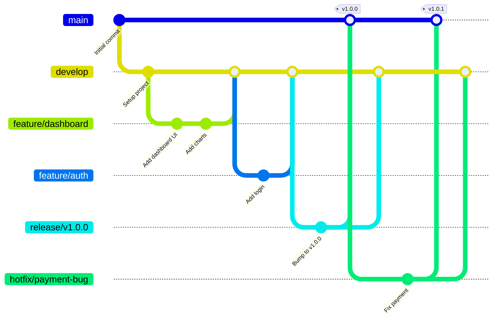

# Gitflow Workflow - NexoraCloud

This document describes the Git workflow used in the **NexoraCloud** project.

---

## 📋 Branch Structure

### Main Branches (Permanent)

#### `main` - Production
- **Purpose:** Production code, always stable
- **Releases:** Official releases are created only from this branch
- **Protection:** ✅ Branch protection enabled
- **Merged from:** `release/*` or `hotfix/*` only
- **CI/CD:** 
  - ✅ Full CI (lint, type-check, build)
  - ✅ Automatic CD (creates releases with semantic-release)

#### `develop` - Development
- **Purpose:** Integration branch, code under active development
- **Protection:** ✅ Requires a PR with review
- **Merged from:** `feature/*`, `hotfix/*`
- **CI/CD:**
  - ✅ Full CI
  - ✅ Optional beta pre-releases (v1.0.0-beta.1)

---

### Temporary Branches (Deleted after merging)

#### `feature/*` - New Features
- **Convention:** `feature/descriptive-name`
- **Examples:**
  - `feature/user-authentication`
  - `feature/export-pdf-invoices`
  - `feature/multi-currency-support`
- **Source:** Created from `develop`
- **Target:** Merged into `develop` through a PR
- **CI/CD:** ✅ Automatic CI on every push

**Flow:**
```bash
# Create a feature from develop
git checkout develop
git pull origin develop
git checkout -b feature/feature-name

# Work on the feature...
git add .
git commit -m "feat: add new feature"

# Push and open a PR to develop
git push origin feature/feature-name
# Open a PR on GitHub: feature/feature-name → develop
```

---

#### `release/*` - Release Preparation
- **Convention:** `release/v1.x.x`
- **Examples:**
  - `release/v1.1.0`
  - `release/v2.0.0`
- **Source:** Created from `develop`
- **Target:** Merged into `main` AND `develop`
- **Purpose:** Final adjustments before launch

**Flow:**
```bash
# Create a release branch from develop
git checkout develop
git pull origin develop
git checkout -b release/v1.1.0

# Update the version in package.json, the changelog, etc.
npm version 1.1.0 --no-git-tag-version
git add package.json package-lock.json
git commit -m "chore: bump version to 1.1.0"

# Merge into main (creates the release automatically)
git checkout main
git pull origin main
git merge --no-ff release/v1.1.0
git push origin main

# Merge back into develop
git checkout develop
git merge --no-ff release/v1.1.0
git push origin develop

# Delete the temporary branch
git branch -d release/v1.1.0
git push origin --delete release/v1.1.0
```

---

#### `hotfix/*` - Urgent Fixes
- **Convention:** `hotfix/bug-description`
- **Examples:**
  - `hotfix/fix-payment-crash`
  - `hotfix/security-vulnerability`
- **Source:** Created from `main`
- **Target:** Merged into `main` AND `develop`
- **Purpose:** Critical fixes in production

**Flow:**
```bash
# Create a hotfix from main
git checkout main
git pull origin main
git checkout -b hotfix/fix-critical-bug

# Fix the bug
git add .
git commit -m "fix: fix critical payment bug"

# Bump the patch version
npm version patch --no-git-tag-version

# Merge into main
git checkout main
git merge --no-ff hotfix/fix-critical-bug
git push origin main

# Merge into develop
git checkout develop
git merge --no-ff hotfix/fix-critical-bug
git push origin develop

# Delete the branch
git branch -d hotfix/fix-critical-bug
git push origin --delete hotfix/fix-critical-bug
```

---

## 🔄 Complete Workflow



---

## 🚀 CI/CD Pipeline

### Continuous Integration (CI)
**Runs on:** All branches (`main`, `develop`, `feature/*`, `hotfix/*`, `release/*`)

**Checks:**
- ✅ Linting (ESLint)
- ✅ Type Checking (TypeScript)
- ✅ Successful build (Vite)

**Platforms:** Windows + Linux

---

### Continuous Deployment (CD)

#### Production Release (main)
- **Trigger:** Push to `main` or a `v*.*.*` tag
- **Action:** Creates an official release on GitHub
- **Files:** Windows (.exe) and Linux (.AppImage, .deb) installers
- **Version:** Per Semantic Versioning

#### Beta Pre-release (develop)
- **Trigger:** Push to `develop` (optional)
- **Action:** Creates a pre-release with the `-beta` label
- **Version:** `v1.0.0-beta.1`, `v1.0.0-beta.2`, etc.

---

## 📝 Commit Convention (Conventional Commits)

We follow **Conventional Commits** to generate changelogs automatically:

### Commit Types
- `feat:` New feature → MINOR version (1.0.0 → 1.1.0)
- `fix:` Bug fix → PATCH version (1.0.0 → 1.0.1)
- `docs:` Documentation only
- `style:` Formatting, semicolons, etc.
- `refactor:` Code refactoring
- `perf:` Performance improvements
- `test:` Add or fix tests
- `chore:` General maintenance
- `ci:` CI/CD changes
- `build:` Build system changes

### Breaking Changes
```bash
git commit -m "feat!: change that breaks compatibility

BREAKING CHANGE: description of the change"
```
→ MAJOR version (1.0.0 → 2.0.0)

---

## 🛡️ Branch Protection

### `main`
- ✅ Requires a pull request
- ✅ Requires code review
- ✅ Requires passing CI
- ✅ Force pushes not allowed
- ✅ Deletion not allowed

### `develop`
- ✅ Requires a pull request
- ✅ Requires passing CI
- ✅ Force pushes not allowed

---

## 📦 Release Checklist

Before creating a release from `release/*` to `main`:

- [ ] All tests pass
- [ ] Version updated in `package.json`
- [ ] Changelog updated with the new features
- [ ] Documentation updated
- [ ] Successful build on Windows and Linux
- [ ] PR reviewed and approved

---

## 🔗 References

- [Gitflow Workflow](https://www.atlassian.com/git/tutorials/comparing-workflows/gitflow-workflow)
- [Conventional Commits](https://www.conventionalcommits.org/)
- [Semantic Versioning](https://semver.org/)

---

*Last updated: October 31, 2026*
